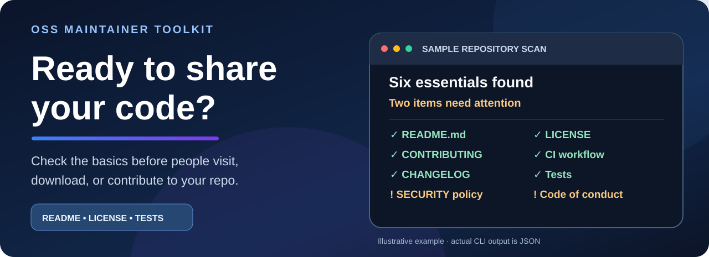
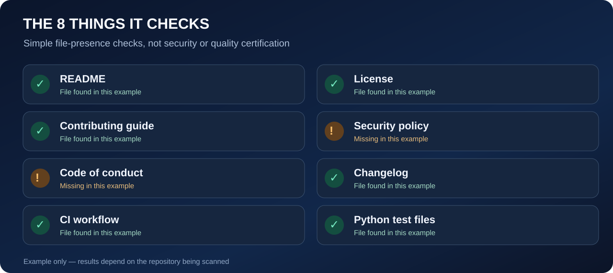
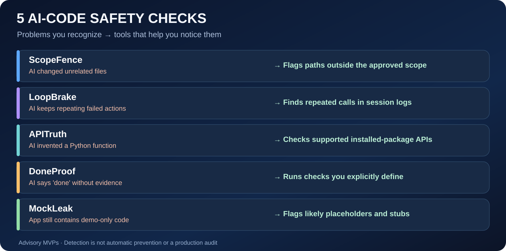

<p align="center">
  
</p>

# OSS Maintainer Toolkit

**A simple pre-publishing checklist for open-source projects.**

**Imagine this:** You finish coding, put your project on GitHub, and want other people to try it. But you forgot a licence, contribution instructions, or tests. This tool checks whether eight common project essentials are present and shows which ones are missing.

**Who is it for?** First-time open-source authors, indie developers, maintainers, and people using AI coding assistants.

**What is this repository?** It contains **one working Python command-line tool**: `oss-maintainer-toolkit`. Below, it also links to a **separate visual catalog of 23 other MVP project concepts**. Those 23 projects are *not included or installable from this repository*.

## What does it actually check?



The eight checks are: README, licence, contributing guide, security policy, code of conduct, changelog, GitHub Actions workflow, and Python test files. It only checks for **matching non-empty files** (or a suitable workflow/test file). It does **not** validate the content, pass tests for you, or secure the repository.

## Try it on your computer

> Requires Python 3.9 or newer and Git. Commands below install only in a local virtual environment.

```bash
git clone https://github.com/subli-ai/oss-maintainer-toolkit.git
cd oss-maintainer-toolkit
python3 -m venv .venv
source .venv/bin/activate
python -m pip install -e .
oss-maintainer-toolkit check .
```

**To scan another project:** `oss-maintainer-toolkit check /path/to/your-project`

**For CI failure when files are missing:** `oss-maintainer-toolkit check . --fail-on-missing`

**To save a JSON report:** `oss-maintainer-toolkit check . --json report.json`

### How to read the result

The command prints a JSON report. For example, a *hypothetical* project with six items present and two missing might show:

```json
{
  "summary": {
    "total": 8,
    "present": 6,
    "missing": ["security_policy", "code_of_conduct"]
  }
}
```

The real report also includes individual checks, matching file paths and limitations. A missing item is a **suggestion to review**, not proof that the repository is unsafe or legally noncompliant.

## Also exploring 23 AI/developer tool ideas



The five tools above help flag unexpected file edits, repeated AI actions, nonexistent APIs, unproven completion and unfinished code. They are **advisory MVPs**, not full automatic prevention systems.


| Collection | What's the problem? | Example projects |
|---|---|---|
| **AI coding safety (5)** | AI-generated changes are hard to trust | ScopeFence, LoopBrake, APITruth, DoneProof, MockLeak |
| **AI infrastructure (5)** | Agents, MCP tools and migrations need better checks | Agent State Receipts, MCP Retry Lab, Spec Oracle |
| **Developer utilities (5)** | New projects need accessible, readable information | A11y Scout, Repo Story, Traceback Guide |
| **Agent operations (8)** | AI cost, permissions and task handoffs are difficult to inspect | Billshock, ActionLedger, PolicyMirror, HandoffVault |

**[Open the illustrated guide to all 23 tools →](docs/PROJECT_SHOWCASE.md)** — Each tool has a plain-English problem, example, what its MVP currently does, and what it does **not** do yet.

**Important:** The 23-project catalog is **documentation**, not 23 repositories or a product installer. Source code for those projects was prepared separately. No public usage or adoption is claimed.

## Development

```bash
python -m pip install -e ".[test]"
python -m pytest
./VERIFY.sh
```

## Contributions and project status

This is an early, dependency-free Python CLI. Practical feedback, bug reports, and focused pull requests are welcome; see [CONTRIBUTING.md](CONTRIBUTING.md) and [SECURITY.md](SECURITY.md).

**What it does not prove:** Software quality, licence compliance, security, test quality, GitHub adoption, package download counts or eligibility for the Claude for Open Source program.

**Licence:** MIT — see [LICENSE](LICENSE).
