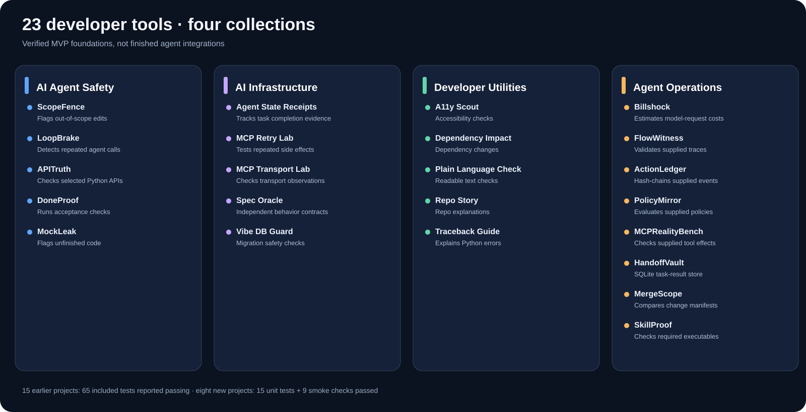

# OSS Maintainer Toolkit

A dependency-free Python CLI for checking basic open-source repository hygiene.

## Install locally

```bash
python3 -m pip install -e ".[test]"
```

Then run:

```bash
oss-maintainer-toolkit check .
```

For machine-readable output:

```bash
oss-maintainer-toolkit check . --json report.json
```

To return a non-zero exit code when any checklist item is missing:

```bash
oss-maintainer-toolkit check . --fail-on-missing
```

## What it checks

- Non-empty README and licence files
- CONTRIBUTING guide, SECURITY policy, CODE_OF_CONDUCT and CHANGELOG
- At least one non-empty GitHub Actions workflow YAML file
- At least one Python test file in a tests or test directory

The tool checks for project-file presence; it does not validate the quality or correctness of their contents. A passing checklist is not a security audit, legal opinion, compliance certification, or measure of project adoption.

It does not measure usage, package downloads, dependent repositories, contributors, merged pull requests, or OpenSSF criticality.

## Development

```bash
python3 -m pip install -e ".[test]"
python3 -m pytest
./VERIFY.sh
```

## Status

Early open-source project. Focused bug reports and pull requests are welcome.

## Licence

MIT. See LICENSE.

## Related open-source project showcase



Explore the [23-project showcase](docs/PROJECT_SHOWCASE.md): AI agent safety checks, AI infrastructure experiments, practical developer utilities, and eight more agent-operations MVPs. The projects are **separate MVPs**, not bundled into this repository, and the showcase makes no claim about public adoption or production readiness.
