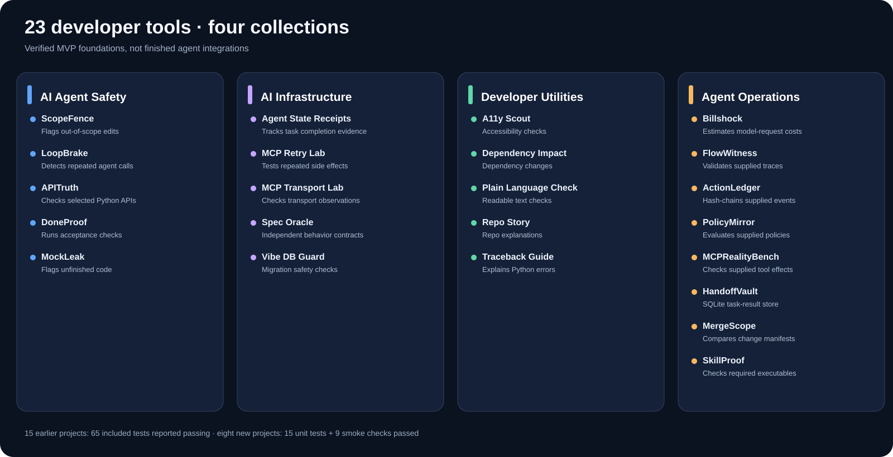

# Open-source project showcase

This is a **catalog of 23 independently scoped MVPs** supplied as four source bundles. These projects are **not included in this repository**, and listing them here does not mean they have been published to GitHub or deployed. This repo remains the independent **OSS Maintainer Toolkit**.

## AI Agent Safety — five tools

| Project | Problem it addresses | Current limit |
|---|---|---|
| **ScopeFence** | AI agent changed files outside an approved path list | Path-based review; does not understand task intent or stop an agent |
| **LoopBrake** | Agent retries the same action or error | Detects patterns in event logs, does not stop the agent |
| **APITruth** | AI references nonexistent Python functions | Best-effort static checks; skips some imports and dynamic APIs |
| **DoneProof** | AI claims completion without checks | Runs only explicitly configured, trusted acceptance commands |
| **MockLeak** | Demo/placeholder code makes an app look finished | Heuristic warnings requiring human review |

## AI Infrastructure — five tools

| Project | Intended use | MVP boundary |
|---|---|---|
| **Agent State Receipts** | Record verifiable task status across agent handoffs | Not an agent transcript recorder |
| **MCP Retry Lab** | Reproduce response-loss and duplicate-side-effect retries | Conformance/fault-injection lab, not a server firewall |
| **MCP Transport Lab** | Review captured trust and request-correlation observations | Not an active vulnerability scanner |
| **Spec Oracle** | Keep behavioral expectations independent of generated code | Human-authored truth, not automatic correctness |
| **Vibe DB Guard** | Examine migration risk and clean local rebuildability | Not a production database security certificate |

## Universal Developer Utilities — five tools

| Project | Plain-language purpose |
|---|---|
| **A11y Scout** | Help spot accessibility issues |
| **Dependency Impact** | Make dependency changes easier to understand |
| **Plain Language Check** | Identify text that is hard to read |
| **Repo Story** | Explain what a repository contains |
| **Traceback Guide** | Make programming error traces easier to interpret |

## Agent Operations — eight more MVPs

| Project | What it currently does | What it does **not** yet do |
|---|---|---|
| **Billshock** | Estimates model-request cost from supplied rates | Does not inspect live endpoints or measure tokens |
| **FlowWitness** | Checks parent links in supplied trace steps | Does not capture browser or database activity |
| **ActionLedger** | Creates and verifies a hash chain over supplied events | Does not collect host-level process/file/network activity |
| **PolicyMirror** | Resolves supplied allow/ask/deny rules | Does not read Codex/Claude client configurations |
| **MCPRealityBench** | Compares declared and supplied observed effects | Does not run an arbitrary MCP server or sandbox |
| **HandoffVault** | Stores and acknowledges local SQLite task results | Has no agent-framework adapter |
| **MergeScope** | Finds overlaps in supplied JSON change manifests | Does not parse Git branches or source ASTs |
| **SkillProof** | Checks whether declared executables are installed | Does not run a skill in a clean container |

**Verification for this eight-project bundle (19 Nov 2026):** 15/15 included unit tests passed, 8/8 Python wheels built, and nine local functional smoke assertions passed. A one-command Mac checker is provided in the separate source ZIP; it has not been run on the user's Mac in this session. These are early 0.1.0 foundations, not completed integrations or independent GitHub repositories.

## Verification and publication

The first three supplied bundles previously reported **65 passing included tests total** (31 agent tools, 17 infrastructure tools and 17 universal tools). The fourth bundle added **15 passing tests**, bringing the portfolio total to **80 included unit tests**. The eight-project bundle also passed eight local wheel builds and nine smoke assertions. These are *project unit tests*, not a claim of complete integration, packaging or security certification. Wheel builds of the first three bundles and live integrations across the portfolio were not fully verified.

The source archives are provided separately to the repository owner. They are **not hosted or installed by this page**. Before publishing any as a standalone repository, test clean installation and real example workflows, review license/dependencies and security, and add screenshots of actual output.

## Why this catalog exists

A potential contributor should be able to see in one place what each project is meant to solve and what it currently cannot do. This catalog is descriptive documentation, not an adoption claim or evidence of eligibility for an open-source grant.
